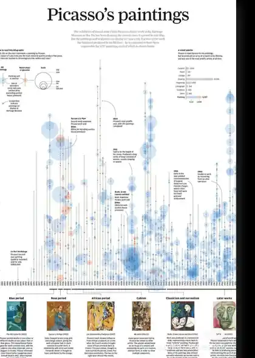

# CASE-0004 绘画编目

> 来源：用户上传的73页课件，第11页。分析基于课堂缩图，并非独立取得原作或底层数据。图片使用许可不明，仓库保留来自课件的研究缩略图，并注明页码与来源；对外再使用需确认原作者许可。

*图源：用户提供的《第三讲-信息图形类型学(2).pdf》，案例对应页码详见本记录；此图为从课件提取的研究缩略图，不代表已获原作者单独授权，转载请核实原始出处与使用许可。*

## 可见事实

绘画作品图像与点位图、说明文字并置，表现可检索的作品集合。

## A. 数据逻辑

主逻辑暂判为「编目」，仍需依据原图完整字段判断次级关系；仅凭栏目名称不能决定数据本质。

## B. 统计图形与计算

**图面有无统计量**：有，但读不出。每幅画一根竖线（等宽，从同一基线长出），线上叠气泡（直径约 4 档、蓝红两色）；右上图例 9 行、底部期间面板 6 格。

**可数结构**（逐项计数与判据见 [数据字典](数据字典.md) §3）：期间 6（可逐字读） / 图例行 9 / 气泡直径档 4 / 气泡色彩 2 / 竖线数百不可数 / 横轴年份不可读。

**能算的与不能算的**：图例 9 行 ≠ 期间 6 格，说明图例至少含一个非期间维度；气泡色彩仅 2 系却要覆盖 6 个期间，说明色彩只承担二分。两条都是数出来的否定结论，用来排除"6 类图例 = 6 个时期"的误读。

## C. 视觉编码
依次检查：点是否代表观察值/节点、线是否代表连接或趋势、面是否承载面积比例、体是否只为场景、图标是否有固定语义/单位、色彩是否为类别或强度编码。任何尺寸与数值的对应关系均须有刻度或图例支持。

## D. 数据与信息架构

原始记录或对象 → 主分类/先后/空间关系 → 主图形及文本注释 → 图例与来源；待原作核实其数据字段、缺失值和统计转换。

## E. 视觉叙事架构

从标题或主体意象进入，通过阅读路径追踪主要关系，再观察辅助图表与结尾注释；该路径是分析推断，未经眼动实验验证。

## 分类和核验

- [编目数据逻辑](../../../../01-信息图形数据逻辑/03-编目型信息图形概念定义.md)
- [表现类型](../../00-标签说明.md)
- **待核验**：高清原作、数据口径、作者与许可、视觉尺寸是否具有严格统计含义。
- **证据等级**：课件第11页的初步视觉观察，不代表跨案例结论。

[案例索引](../../../案例索引.md) · [课件分类核验](../../../课件来源与分类核验.md)

## 修订记录

- 2026-11-19：根据课件第11页创建初步分析，未复制原图。
