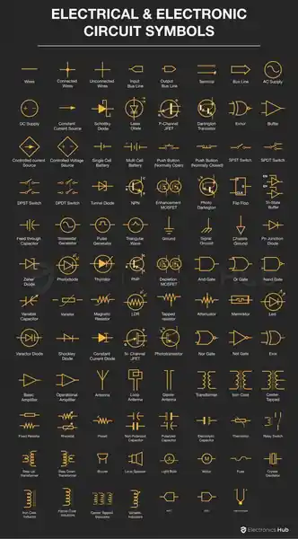

# CASE-0005 电路符号图鉴

> 来源：用户上传的73页课件，第14页。分析基于课堂缩图，并非独立取得原作或底层数据。图片使用许可不明，仓库保留来自课件的研究缩略图，并注明页码与来源；对外再使用需确认原作者许可。

*图源：用户提供的《第三讲-信息图形类型学(2).pdf》，案例对应页码详见本记录；此图为从课件提取的研究缩略图，不代表已获原作者单独授权，转载请核实原始出处与使用许可。*

## 可见事实

课件归入字母表章节；画面显示符号与名称矩阵，但A–Z索引未得到证实。

## A. 数据逻辑

主逻辑暂判为「编目」，仍需依据原图完整字段判断次级关系；仅凭栏目名称不能决定数据本质。

## B. 统计图形与计算

**图面有无统计量**：没有。整版是 8 列栅格，每格一个电路符号 + 一行英文名，全图零数值。

**可数结构**（逐项计数与判据见 [数据字典](数据字典.md) §3）：列 8 / 行 14（按行距推算） / 符号总数 ≈112 / 可辨符号名 6 / 分组标题 0。

**能算的与不能算的**：8 × 14 = 112；若末行为空则为 104。两值相差正好一行，说明列数是硬约束、行数是唯一不确定项，逐格点数得到 104 或 112 即可定案。

## C. 视觉编码
依次检查：点是否代表观察值/节点、线是否代表连接或趋势、面是否承载面积比例、体是否只为场景、图标是否有固定语义/单位、色彩是否为类别或强度编码。任何尺寸与数值的对应关系均须有刻度或图例支持。

## D. 数据与信息架构

原始记录或对象 → 主分类/先后/空间关系 → 主图形及文本注释 → 图例与来源；待原作核实其数据字段、缺失值和统计转换。

## E. 视觉叙事架构

从标题或主体意象进入，通过阅读路径追踪主要关系，再观察辅助图表与结尾注释；该路径是分析推断，未经眼动实验验证。

## 分类和核验

- [编目数据逻辑](../../../../01-信息图形数据逻辑/04-字母表型信息图形概念定义.md)
- [表现类型](../../00-标签说明.md)
- **待核验**：高清原作、数据口径、作者与许可、视觉尺寸是否具有严格统计含义。
- **证据等级**：课件第14页的初步视觉观察，不代表跨案例结论。

[案例索引](../../../案例索引.md) · [课件分类核验](../../../课件来源与分类核验.md)

## 修订记录

- 2026-11-19：根据课件第14页创建初步分析，未复制原图。
