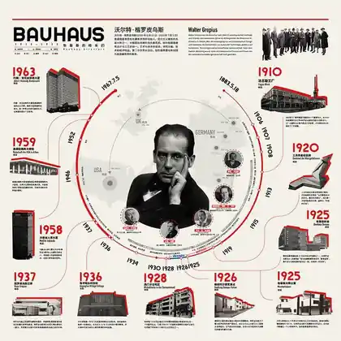

# CASE-0009 包豪斯时间轴

> 来源：用户上传的73页课件，第24页。分析基于课堂缩图，并非独立取得原作或底层数据。图片使用许可不明，仓库保留来自课件的研究缩略图，并注明页码与来源；对外再使用需确认原作者许可。
>
> **数据表**：`partial`（部分）。13 个节点已转录年份，其中 5 个节点的建筑名因字号过小不可辨，如实标 `not_readable`，不据形近补全。详见 [数据字典](数据字典.md)。

*图源：用户提供的《第三讲-信息图形类型学(2).pdf》，案例对应页码详见本记录；此图为从课件提取的研究缩略图，不代表已获原作者单独授权，转载请核实原始出处与使用许可。*

## 可见事实

BAUHAUS 标题、年份、建筑插图和圆弧路径组织历史进程；不能假定圆弧距离等于时间差。

环形轴从顶端 1883.5.18 起顺时针绕行，经右上 1910、右侧 1920、下方 1925–1928、左下 1936–1937、左侧 1958–1959、左上 1963，收于顶部偏左的 1967.7.5。起点与终点在环顶相邻，构成闭合环。环内嵌套人物肖像、GERMANY／USA 底图与机构阶段标签；11 个红色年份节点各配一幅建筑插图，以细白引线连回环上。

## A. 数据逻辑

主逻辑判定为**编年**，且证据充分（不再只是"暂判"）：横轴为时间，节点按年份先后排列，`seq` 与 `year_value` 单调对应（见基础表 N01→N13）。

次级关系是**归属**：每个年份节点挂一件格罗皮乌斯的作品，形成"人物—作品"的一对多结构。这不是层级型的主逻辑，因为层级型要求父子分解关系，而此处的年份之间没有包含关系。

一个容易误判的点：环内有 5 个人物头像与 3 个阶段标签（魏玛／德绍／柏林），看起来像"人物层级"或"机构分期"。但头像不是轴的刻度，而是对轴所经时段的注脚——它们依附于年份，不组织年份。因此次级关系仍以归属计，不升为层级。

字段层面：本图的最小数据单位是"节点"，至少含（年份，作品，方位）三项。作品名的**缺失是本图的固有属性**，不是转录失败——缩图上 5 个节点的标题字高约 4–5 px，低于可辨认下限。这与 CASE-0007 那些"字小但仍可辨"的情况不同，故标 `not_readable` 而非 `low`。

## B. 统计图形与计算

本图无条形、面积、饼图，唯一的定量通道是**弧长**。因此 B 节要回答的问题是：弧长能不能读数？

**结论：不能，且偏差达两个数量级。**

按 [数据字典](数据字典.md) §9.2 的复算：

| 对照 | 弧长（目测） | 对应年数 | 折合 |
|---|---|---|---|
| 起点 1883.5.18 → 终点 1967.7.5 | 约 30°（环顶缺口） | 84 年 | 2.8 年／度 |
| 1925 → 1926（底部两节点） | 约 12° | 1 年 | 0.08 年／度 |

两者相差约 **34 倍**。84 年压进 30°，1 年却占 12°——若读者按角度估计时长，会把 1925–1926 这一年读成比 1883–1967 这 84 年更长。这不是测量误差可以解释的量级，而是设计上根本没有建立角度—年份的映射。

图表中是否存在其他可复算项？逐个排查：

- **计数**：11 个红字节点、2 个日期标记、15 条轴刻度、5 个头像、2 幅底图——均可数，已入辅助表。
- **比例**：包豪斯存续 14 年占全图 84 年的 16.7%，却占 11 个节点的 45.5%，密度比 **2.7 倍**。反向，1937–1958 的 21 年占 25% 时长，只有 1 个节点，密度比 **0.36 倍**。视觉权重与时间长度脱钩，方向明确、量级可信。
- **趋势**：无。环形轴不表达增减。
- **面积/体积**：建筑插图是轴测立体，尺寸随版面而非随建筑实际规模变化，**不承载面积编码**。这点须明写，否则容易被读成"楼越大越重要"。

## C. 视觉编码

**位置**：极坐标。角度承载"先后"，半径承载"层级"——外圈是生平与作品，内圈是人物与地理。这是本图最核心的编码决策：**用半径而非颜色区分信息层级**，因此环内环外可以共用同一套红色。

**点**：环上的小红点标节点位置，与红字年份严格配对，一个点一个年份。点的大小恒定，不编码数值——即"点只标位置，不标量"。

**线**：三段功能不同的线，须分开看。

1. **红色粗弧**——主轴本身，同时也是装饰；它既表示"时间在走"，又被加粗强调，两种功能叠在一条线上。
2. **细白引线**——把环上节点连到环外建筑插图。引线走向自由，长度不等，**不表示距离或时长**。
3. **灰色虚线圈**——底图上标示人物活动的地理范围（GERMANY／USA），是空间注脚，不是时间刻度。

**面**：建筑插图为轴测立体，用于识别而非计量。红色描边只勾建筑轮廓的一侧，作用是"从米色底上把楼提出来"，属图底分离手段，不是类别编码。

**色彩**：红／黑／米三色。红同时用于年份数字、节点圆点、弧线、建筑轮廓——四种对象共用一个颜色，**色彩不承担分类功能**，只承担"强调"。这意味着读者无法靠颜色区分"哪年是作品、哪年是事件"，只能靠字样大小（红大字＝作品，小字＝刻度，带月日＝生死）。

**文字**：标题 BAUHAUS 用超粗无衬线，年份用同款但更细，层级靠字号而非字重。中文标题字高最小，是全图最先失效的通道。

## D. 数据与信息架构

三层同心结构，由外向内：

| 层 | 内容 | 承载关系 |
|---|---|---|
| 外圈（环外） | 11 个年份节点 + 建筑插图 + 说明段落 | 时间 × 作品归属 |
| 环上 | 红字年份、红点、小字刻度 | 顺序与定位 |
| 内圈（环内） | 格罗皮乌斯巨幅肖像、5 个人物头像、GERMANY／USA 底图、阶段标签 | 人物与地理注脚 |

叙事重心明显偏向人物：格罗皮乌斯的肖像占据环心，面积超过任何单幅建筑插图，形成"一切围绕此人"的向心结构。这是**架构即论点**——图不是中立的年表，而是"以格罗皮乌斯为中心看包豪斯"的立场表达。

缺失值处理值得注意：5 个节点的标题不可辨，但插图仍在。读者能看见"有一栋楼"，却读不出"哪栋楼"。这说明原作的架构把**图像识别**当作主通道、文字当作辅通道；一旦分辨率下降，辅通道先失效，主通道仍可辨认轮廓。这是缩图研究该类图时的系统性偏差，记录时应说明。

## E. 视觉叙事架构

阅读路径（分析推断，未经眼动验证）：BAUHAUS 标题 → 右上 1883.5.18 起点 → 顺时针沿弧 → 环心肖像（视线被最大面积吸走）→ 底部 1925–1928 密集区 → 左上 1967.7.5 收束。

三处叙事设计值得记：

**一、闭环与不可逆的冲突。** 环形在视觉上暗示"循环、周而复始"，但编年轴的本质是不可逆。起止两点在环顶相邻，读者很容易把 1967 读成"又回到 1883"。这是形式与语义的直接冲突：**用循环的容器装线性的内容**。它不是低级错误——闭环让"一生"获得完整的仪式感——但它要求读者主动抵抗形式的暗示。若换成螺旋（起点在中心、终点在外缘），同样的仪式感可以不牺牲方向性。

**二、密度倒置。** 包豪斯 14 年被放大 2.7 倍，流亡美国 20 余年只剩 1 个节点。这符合"主题优先"的编辑逻辑（图讲的是包豪斯），却与"编年"的中立承诺相悖。读者若不知情，会把"节点多"误读为"事情多、更重要"。

**三、宏大叙事与失效通道。** 图把最重的信息（作品名）放在最小的字号上，把最轻的信息（建筑轮廓）放在最大的面积上。高清原作上这是一种"先看图、再读字"的分层阅读设计；缩到 420 px 后，大字仍在、小字全糊，图就退化成"一排楼 + 一串年份"，作品名整体丢失。**这种设计对分辨率高度敏感**，是评估信息图形鲁棒性时值得引用的反例。

叙事落点：结尾 1967.7.5 之后没有总结段落，环闭合即结束。图把"评价"留给读者，只提供事实与图像。

## 分类和核验

- [编年数据逻辑](../../../../01-信息图形数据逻辑/01-编年型信息图形概念定义.md)
- [表现类型](../../00-标签说明.md)
- **待核验**：高清原作、5 个不可辨节点的项目名、内圈刻度语义、5 个人物头像身份、起止两点夹角的像素级测量。
- **证据等级**：课件第24页的初步视觉观察 + 本库自建数据表的复算；密度比与角度比为分析者计算，非原作者提供。

[案例索引](../../../案例索引.md) · [课件分类核验](../../../课件来源与分类核验.md) · [数据字典](数据字典.md)

## 修订记录

- 2026-11-19：根据课件第24页创建初步分析，未复制原图。
- 2026-11-24：由 `none` 升为 `partial`。建立 13 节点基础表与 25 行辅助表；B 节由通用套话改为弧长—年份非线性的复算（34 倍偏差）与节点密度比（2.7 倍）；C 节补三段线的功能区分与"色彩不承担分类"；D 节补三层同心架构；E 节补闭环与不可逆的冲突、密度倒置、分辨率敏感性三点。5 个不可辨节点如实标 `not_readable`，未据形近补全。
