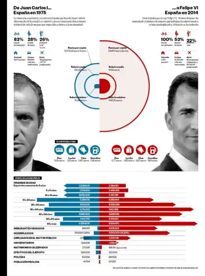

# CASE-0012 体育人物比较

> 来源：用户上传的73页课件，第27页。分析基于课堂缩图，并非独立取得原作或底层数据。图片使用许可不明，仓库保留来自课件的研究缩略图，并注明页码与来源；对外再使用需确认原作者许可。

*图源：用户提供的《第三讲-信息图形类型学(2).pdf》，案例对应页码详见本记录；此图为从课件提取的研究缩略图，不代表已获原作者单独授权，转载请核实原始出处与使用许可。*

## 可见事实

并排肖像、中央环形和双侧条带比较同类指标，来源与数值待确认。

## A. 数据逻辑

主逻辑暂判为「编目」，仍需依据原图完整字段判断次级关系；仅凭栏目名称不能决定数据本质。

## B. 统计图形与计算

**数据表**：[基础数据集.csv](基础数据集.csv)（11 列 × 24 行）× [辅助指标.csv](辅助指标.csv) ｜ 字典：[数据字典.md](数据字典.md)

按区块分五段：顶部三组百分比（3 行，两值均可逐字读）、中部同心圆（3 行，仅存标签）、国家指标行（2 行）、年龄组（9 行）、社会指标行（7 行）。**可逐字读出的只有 7 个数**：83→100、28→53、26→22（三组百分比）与 73.3→82.8 年（预期寿命）。

**复算**：H01 由 83 升至 100，增幅 20.5%；H02 由 28 升至 53，增幅 89.3%；H03 由 26 降至 22，降幅 15.4%——三者中只有 H02 接近翻倍，H03 是唯一下降项。预期寿命 82.8 − 73.3 = 9.5 年，38 年跨度内年均 +0.25 年。年龄组与 7 项社会指标因端点数字达 6–7 位、缩图下只能辨出前两位，一律留空标 `not_readable`，未做估读。

## C. 视觉编码
依次检查：点是否代表观察值/节点、线是否代表连接或趋势、面是否承载面积比例、体是否只为场景、图标是否有固定语义/单位、色彩是否为类别或强度编码。任何尺寸与数值的对应关系均须有刻度或图例支持。

## D. 数据与信息架构

原始记录或对象 → 主分类/先后/空间关系 → 主图形及文本注释 → 图例与来源；待原作核实其数据字段、缺失值和统计转换。

## E. 视觉叙事架构

从标题或主体意象进入，通过阅读路径追踪主要关系，再观察辅助图表与结尾注释；该路径是分析推断，未经眼动实验验证。

## 分类和核验

- [编目数据逻辑](../../../../01-信息图形数据逻辑/03-编目型信息图形概念定义.md)
- [表现类型](../../00-标签说明.md)
- **待核验**：高清原作、数据口径、作者与许可、视觉尺寸是否具有严格统计含义。
- **证据等级**：课件第27页的初步视觉观察，不代表跨案例结论。

[案例索引](../../../案例索引.md) · [课件分类核验](../../../课件来源与分类核验.md)

## 修订记录

- 2026-11-19：根据课件第27页创建初步分析，未复制原图。
