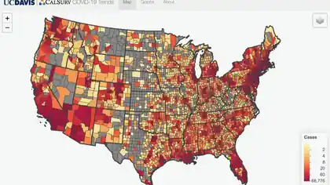

# CASE-0003 美国疫情地图

> 来源：用户上传的73页课件，第9页。分析基于课堂缩图，并非独立取得原作或底层数据。图片使用许可不明，仓库保留来自课件的研究缩略图，并注明页码与来源；对外再使用需确认原作者许可。

*图源：用户提供的《第三讲-信息图形类型学(2).pdf》，案例对应页码详见本记录；此图为从课件提取的研究缩略图，不代表已获原作者单独授权，转载请核实原始出处与使用许可。*

## 可见事实

美国县级分区配色是地理编码；课件却放在层级型章节附近，分类不能照搬。

## 数据表

- 基础数据集：[CASE-0003-基础数据集.csv](基础数据集.csv)——**9 列 0 行**，仅表头。县级观测值不可转录。
- 辅助指标：[CASE-0003-辅助指标.csv](辅助指标.csv)——图例六刻度（2 / 4 / 8 / 20 / 60 / 68,775）+ 画布事实 4 条。
- 数据字典：[CASE-0003-数据字典.md](数据字典.md)
- 状态：`partial`。可读的是**图例结构**，不是**县值**。

> 基础表为空不是漏填。缩图宽 420 px，全美约 3000 个县级单元 → 约 0.14 px/县，低于 1 px/县的辨认下限。这个除法本身就是"不可转录"的判据，写在字典 §10。

## A. 数据逻辑

主逻辑暂判为「地理」，仍需依据原图完整字段判断次级关系；仅凭栏目名称不能决定数据本质。

## B. 统计图形与计算

分级设色地图（choropleth），统计任务是**空间分布比较**，不是精确读数。

- **标度结构**：图例六刻度 2 → 4 → 8 → 20 → 60 → 68,775（辅助表 T01–T06）。相邻比值 2.0、2.0、2.5、3.0、**1146.3**——前五档是分档阈值，末档是连续上限，**两种标度混用**。因此色带不能读作"六档等距"，深红区间实际容纳了 60 到 6.8 万的巨大跨度，大部分县会被压进同一色阶。
- **可复算项**：刻度单调性成立；刻度计数 6；末档与前档之比 ≈ 1146。
- **不可复算项**：县级数值、分母（人口基数）、统计期、灰色区块语义——均未标注，不虚构。

## C. 视觉编码

依次检查：点是否代表观察值/节点、线是否代表连接或趋势、面是否承载面积比例、体是否只为场景、图标是否有固定语义/单位、色彩是否为类别或强度编码。任何尺寸与数值的对应关系均须有刻度或图例支持。

## D. 数据与信息架构

原始记录或对象 → 主分类/先后/空间关系 → 主图形及文本注释 → 图例与来源；待原作核实其数据字段、缺失值和统计转换。

## E. 视觉叙事架构

从标题或主体意象进入，通过阅读路径追踪主要关系，再观察辅助图表与结尾注释；该路径是分析推断，未经眼动实验验证。

## 分类和核验

- [地理数据逻辑](../../../../01-信息图形数据逻辑/05-地理图形信息图形概念定义.md)
- [表现类型](../../00-标签说明.md)
- **待核验**：高清原作、数据口径、作者与许可、视觉尺寸是否具有严格统计含义。
- **证据等级**：课件第9页的初步视觉观察，不代表跨案例结论。

[案例索引](../../../案例索引.md) · [课件分类核验](../../../课件来源与分类核验.md)

## 修订记录

- 2026-11-19：根据课件第9页创建初步分析，未复制原图。
- 2026-11-24：按 [数据表规范](../../../数据表规范.md) 建 `partial` 数据表；B 节由通用套话改为基于图例刻度的具体标度分析（发现末档与前五档混用两种标度）。
