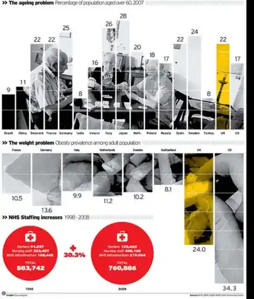

# CASE-0014 摄影嵌入图表

> 来源：用户上传的73页课件，第29页。分析基于课堂缩图，并非独立取得原作或底层数据。图片使用许可不明，仓库保留来自课件的研究缩略图，并注明页码与来源；对外再使用需确认原作者许可。

*图源：用户提供的《第三讲-信息图形类型学(2).pdf》，案例对应页码详见本记录；此图为从课件提取的研究缩略图，不代表已获原作者单独授权，转载请核实原始出处与使用许可。*

## 可见事实

柱形统计叠加新闻照片与高亮色，照片承担语境而非量尺。

## A. 数据逻辑

主逻辑暂判为「编年」，仍需依据原图完整字段判断次级关系；仅凭栏目名称不能决定数据本质。

## B. 统计图形与计算

**数据表**：[基础数据集.csv](基础数据集.csv)（11 列 × 32 行）× [辅助指标.csv](辅助指标.csv) ｜ 字典：[数据字典.md](数据字典.md)

三组柱图分三段：老龄化 17 国（pct，2007）、肥胖率 8 国（pct，原图未标年份）、NHS 员工 7 项（1998 / 2008）。25 个国别值与 NHS 两个总数、一个增幅均可辨，只有 NHS 的医生与护理四个分项读不出，留空标 `not_readable`。

**复算**：**NHS 增幅互证**：760,886 ÷ 583,742 − 1 = 30.35%，图上印刷形似 30.3%，差 0.05 个百分点 → 两个总数与增幅互证成立，反证读数正确。**老龄化均值**：17 国求和 315，除以 17 得 18.5%（非人口加权，不得当作"全球水平"）。**英美落差**：34.3 − 24.0 = 10.3 个百分点，英国为美国的 70.0%，其余六国集中在 8.1–13.6%。

## C. 视觉编码
依次检查：点是否代表观察值/节点、线是否代表连接或趋势、面是否承载面积比例、体是否只为场景、图标是否有固定语义/单位、色彩是否为类别或强度编码。任何尺寸与数值的对应关系均须有刻度或图例支持。

## D. 数据与信息架构

原始记录或对象 → 主分类/先后/空间关系 → 主图形及文本注释 → 图例与来源；待原作核实其数据字段、缺失值和统计转换。

## E. 视觉叙事架构

从标题或主体意象进入，通过阅读路径追踪主要关系，再观察辅助图表与结尾注释；该路径是分析推断，未经眼动实验验证。

## 分类和核验

- [编年数据逻辑](../../../../01-信息图形数据逻辑/01-编年型信息图形概念定义.md)
- [表现类型](../../00-标签说明.md)
- **待核验**：高清原作、数据口径、作者与许可、视觉尺寸是否具有严格统计含义。
- **证据等级**：课件第29页的初步视觉观察，不代表跨案例结论。

[案例索引](../../../案例索引.md) · [课件分类核验](../../../课件来源与分类核验.md)

## 修订记录

- 2026-11-19：根据课件第29页创建初步分析，未复制原图。
