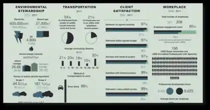

# CASE-0007 多主题混合统计

> 来源：用户上传的73页课件，第22页。分析基于课堂缩图，并非独立取得原作或底层数据。图片使用许可不明，仓库保留来自课件的研究缩略图，并注明页码与来源；对外再使用需确认原作者许可。

*图源：用户提供的《第三讲-信息图形类型学(2).pdf》，案例对应页码详见本记录；此图为从课件提取的研究缩略图，不代表已获原作者单独授权，转载请核实原始出处与使用许可。*

## 可见事实

环境、交通、满意度、职场栏目结合条形、比例及人物符号，多编码解释共同主题。

## 数据表

- 基础数据集：[CASE-0007-基础数据集.csv](../案例数据/CASE-0007-基础数据集.csv)——12 列 27 行，四面板逐指标转录。
- 数据字典：[CASE-0007-数据字典.md](../案例数据/CASE-0007-数据字典.md)
- 状态：`partial`。26 项指标值可读，1 项（人均学时）标 `not_readable`；五条满意度指标的**文字标签**字形过小，用占位键 `satisfaction_item_1…5` 记录，不逐字猜。

## A. 数据逻辑

主逻辑暂判为「编目」，仍需依据原图完整字段判断次级关系；仅凭栏目名称不能决定数据本质。

## B. 统计图形与计算

四面板各自独立的统计图形，**面板间不同年、不同口径，不可相加或平均**（2012 / 2011 / 2011 / 2010–2011）。

| 面板 | 图形 | 可复算项 |
|---|---|---|
| Environmental Stewardship | 图标 + 双柱对照 + 数值块 | 两项能耗强度 20.60 与 50.60，比值 2.46——若为场地/一次能源口径，该比值即转换损耗系数，但原图未标单位，**仅能记为形似** |
| Transportation | 两个饼图 + 五档微型条形 | 通勤距离五档 21+20+19+10+30 = **100** ✅ 构成闭合，说明是互斥穷尽占比；尽管区间标签缺 21–25 档，数值自洽 |
| Client Satisfaction | 五条水平条形 | 97/97/97/99/97，众数 97，一项 99；四条同值 ⇒ 更像"达标率"而非连续测评分布 |
| Workplace | 计数块 + 单条 + 人形网格 + 双圆点 | 人形网格标注 156；职业发展学时两个圆点 2,500 与 9,025，口径差异未标 |

**一处矛盾**：面板三右侧 `258` 与面板四 `256` 均为"员工总数"。两者面板、年份不同，可能分属不同口径（如含/不含承包商），原图未说明——**两值并存，不择一、不平均**（字典 §10.3）。

## C. 视觉编码

依次检查：点是否代表观察值/节点、线是否代表连接或趋势、面是否承载面积比例、体是否只为场景、图标是否有固定语义/单位、色彩是否为类别或强度编码。任何尺寸与数值的对应关系均须有刻度或图例支持。

## D. 数据与信息架构

原始记录或对象 → 主分类/先后/空间关系 → 主图形及文本注释 → 图例与来源；待原作核实其数据字段、缺失值和统计转换。

## E. 视觉叙事架构

从标题或主体意象进入，通过阅读路径追踪主要关系，再观察辅助图表与结尾注释；该路径是分析推断，未经眼动实验验证。

## 分类和核验

- [编目数据逻辑](../../01-信息图形数据逻辑/03-编目型信息图形概念定义.md)
- [表现类型](../01-混合型信息图形-Mixed-Charts.md)
- **待核验**：高清原作、数据口径、作者与许可、视觉尺寸是否具有严格统计含义。
- **证据等级**：课件第22页的初步视觉观察，不代表跨案例结论。

[案例索引](../案例索引.md) · [课件分类核验](../课件来源与分类核验.md)

## 修订记录

- 2026-11-19：根据课件第22页创建初步分析，未复制原图。
- 2026-11-24：按 [数据表规范](../数据表规范.md) 建 `partial` 数据表（27 行）；B 节改为按四面板逐项复算，补通勤五档合计 100% 的闭合计验与 258/256 员工数矛盾登记。
